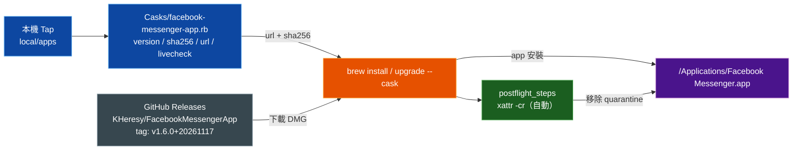
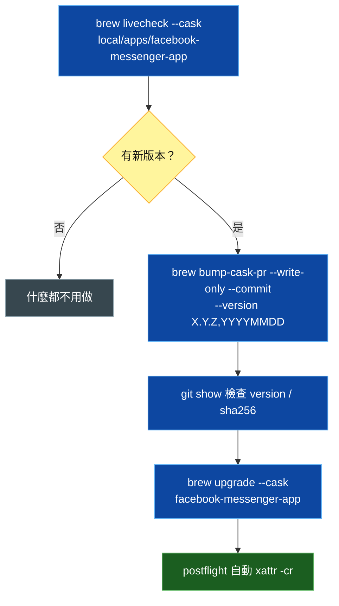

# 以 Homebrew Custom Tap 安裝 Facebook Messenger App（macOS）

[回到 README](README-tw.md) | [English](README-macos-brew.md)

本專案沒有用 Apple 開發者憑證簽章，所以直接安裝 DMG 後，macOS Gatekeeper 常會跳出「應用程式已損毀，無法開啟」，你得自己執行 `sudo xattr -cr ...`。

改用 **Homebrew 自訂 Tap（custom tap）** 安裝後，cask 裡的 `postflight_steps` 會在每次安裝或升級後**自動執行** `/usr/bin/xattr -cr`，不用再手動輸入。

> **比喻**：Tap 是你自己開的一間小商店，Cask 是貨架上的一張「商品說明卡」，上面寫著去哪裡進貨（`url`）、怎麼驗貨（`sha256`）、怎麼上架（`app`），以及上架後的處理步驟（`postflight_steps`）。Homebrew 是店員，照著說明卡做事。之後要換新版，只要更新說明卡就好。

## 架構總覽



## 一、建立 Custom Tap（只需做一次）

### 1. 建立 Tap

```bash
brew tap-new local/apps
```

- Tap 會建在 `$(brew --repository)/Library/Taps/local/homebrew-apps`（Apple Silicon 預設為 `/opt/homebrew/Library/Taps/local/homebrew-apps`）。
- 這個目錄本身就是一個 git repo，並附帶 `.github/workflows` 範本（只有推到 GitHub 時才用得到）。
- 隨時可用下列指令找到它：

```bash
TAP_DIR="$(brew --repository local/apps)"
echo "$TAP_DIR"
```

> 名稱 `local/apps` 可以自訂，格式是 `<user>/<repo>`，對應目錄 `<user>/homebrew-<repo>`。若之後要分享給別人，可以改用 GitHub 帳號名稱，例如 `yourname/apps`，再推到 `github.com/yourname/homebrew-apps`。

### 2. 取得 DMG 的 SHA256

到 [Releases](https://github.com/KHeresy/FacebookMessengerApp/releases) 確認最新的 tag（例如 `v1.6.0+20261117`），然後計算 DMG 的雜湊值：

```bash
VER=1.6.0
BUILD=20261117
curl -L -o /tmp/fbm.dmg \
  "https://github.com/KHeresy/FacebookMessengerApp/releases/download/v${VER}%2B${BUILD}/Facebook.Messenger-${VER}-arm64.dmg"
shasum -a 256 /tmp/fbm.dmg
```

> tag 中的 `+` 在網址裡必須寫成 `%2B`。

### 3. 建立 Cask 檔

建立 `"$(brew --repository local/apps)/Casks/facebook-messenger-app.rb"`：

```ruby
cask "facebook-messenger-app" do
  version "1.6.0,20261117"
  sha256 "b4d443531e230b947d13c33f783745d28311181af48641144cab22cd98aefec1"

  url "https://github.com/KHeresy/FacebookMessengerApp/releases/download/v#{version.csv.first}%2B#{version.csv.second}/Facebook.Messenger-#{version.csv.first}-arm64.dmg"
  name "Facebook Messenger App"
  desc "Unofficial Facebook Messenger desktop application"
  homepage "https://github.com/KHeresy/FacebookMessengerApp"

  livecheck do
    url :url
    regex(/^v?(\d+(?:\.\d+)+)\+(\d{8})$/i)
    strategy :github_latest do |json, regex|
      json["tag_name"]&.match(regex) do |match|
        "#{match[1]},#{match[2]}"
      end
    end
  end

  depends_on arch: :arm64
  depends_on macos: :tahoe

  app "Facebook Messenger.app"

  postflight_steps do
    run "/usr/bin/xattr",
        args: ["-cr", "{{appdir}}/Facebook Messenger.app"],
        sudo: true
  end
end
```

各段說明：

| 區塊 | 作用 |
| --- | --- |
| `version "1.6.0,20261117"` | 上游 tag 是 `v1.6.0+20261117`，兩段資訊用逗號分開，再用 `version.csv.first` / `version.csv.second` 組回網址 |
| `sha256` | DMG 的雜湊值，下載內容不符時 brew 會拒絕安裝 |
| `livecheck` | 讀 GitHub 最新 release 的 `tag_name`，轉成 `1.6.0,20261117` 格式，讓 `brew livecheck` 能比對新版 |
| `depends_on arch: :arm64` | 目前只抓 arm64 DMG，限定 Apple Silicon |
| `depends_on macos: :tahoe` | 限定 macOS 26 Tahoe **以上**（符號寫法即代表 `>=`，`brew info` 會顯示 `macOS >= 26`）；少了這行 `brew style` 會報 `Homebrew/OSDependsOn` |
| `app` | 把 DMG 裡的 `.app` 複製到 `/Applications` |
| `postflight_steps` → `run` | 安裝後以 `sudo` 執行 `xattr -cr`，移除 quarantine 屬性；`{{appdir}}` 會自動換成 App 的安裝目錄（預設 `/Applications`） |

### 4. 檢查 Cask 並提交

```bash
cd "$(brew --repository local/apps)"

brew style --fix --cask local/apps/facebook-messenger-app  # 格式檢查，可自動修正
brew livecheck --cask local/apps/facebook-messenger-app    # 確認 livecheck 抓得到版本

git add Casks/facebook-messenger-app.rb
git commit -m "Add Facebook Messenger App cask"
```

> 上面的 cask 已加上 `depends_on macos: :tahoe`，`brew style` 應顯示 `no offenses detected`。

### 5. 安裝

```bash
brew install --cask local/apps/facebook-messenger-app
```

安裝最後會要求輸入一次密碼（因為 `xattr` 是用 `sudo` 執行），完成後就能直接開啟 App。

> 若之前已經手動從 DMG 安裝過，請先把 `/Applications/Facebook Messenger.app` 刪除，或用 `brew install --cask --force ...` 讓 brew 接手管理。

## 二、日常維護：檢查與更新

### 流程總覽



### 1. 檢查上游有沒有新版

```bash
brew livecheck --cask local/apps/facebook-messenger-app
```

輸出範例：

```text
facebook-messenger-app: 1.6.0,20261117 ==> 1.6.0,20261201
```

箭頭左邊是 Tap 目前寫的版本，右邊是 GitHub 最新版本；兩邊相同就代表已是最新版。

也可以查看本機已安裝的版本，以及 brew 認為需要升級的 cask：

```bash
brew info --cask local/apps/facebook-messenger-app
brew outdated --cask
```

> 注意：`brew outdated` 只會比對「Tap 裡的版本」和「已安裝版本」。上游發新版但 Tap 還沒更新時，這個指令不會顯示，所以要先用 `livecheck` 檢查。

### 2. 更新 Tap 中的 Cask（版本 + SHA256）

用 Homebrew 內建的 `bump-cask-pr`，搭配 `--write-only`，只修改本機檔案，不會建立遠端 PR。它會自動下載新版 DMG 並計算 SHA256：

```bash
brew bump-cask-pr \
  --write-only \
  --commit \
  --version 1.6.0,20261201 \
  local/apps/facebook-messenger-app
```

- `--version` 使用與 cask 相同的格式：`<版本>,<日期>`，也就是 `livecheck` 右邊顯示的字串。
- `--commit` 會直接在 Tap repo 裡建立 commit；若想先檢查再自己 commit，就拿掉這個參數。

確認修改內容：

```bash
git -C "$(brew --repository local/apps)" show --stat HEAD
git -C "$(brew --repository local/apps)" show HEAD
```

#### 手動更新方式（bump-cask-pr 失敗時）

1. 依照「建立 Custom Tap」的步驟 2 下載新版 DMG 並計算 `shasum -a 256`。
2. 編輯 `"$(brew --repository local/apps)/Casks/facebook-messenger-app.rb"`，修改 `version` 與 `sha256`。
3. 執行 `brew style --cask local/apps/facebook-messenger-app` 檢查格式。
4. 執行 `git commit -am "facebook-messenger-app <新版本>"`。

### 3. 升級 App

```bash
brew upgrade --cask facebook-messenger-app
```

升級完成後，`postflight_steps` 會再次自動執行 `xattr -cr`，所以升級後也能直接開啟 App。

> App 內建的「自動更新通知」仍會提醒有新版，但**請改用 brew 升級**，不要手動下載 DMG 覆蓋。手動覆蓋會讓 brew 記錄的版本和實際版本不一致，而且需要再自己執行 `xattr`。

### 4. 一行完成（懶人版）

```bash
NEW=$(brew livecheck --cask --json local/apps/facebook-messenger-app | jq -r '.[0].version.latest') && \
brew bump-cask-pr --write-only --commit --version "$NEW" local/apps/facebook-messenger-app && \
brew upgrade --cask facebook-messenger-app
```

已經是最新版時，`bump-cask-pr` 會回報版本相同並停止，不會改動任何檔案。（需要安裝 `jq`：`brew install jq`。）

### 5. 更新 Tap 本身

- **純本機 Tap（像 `local/apps` 這種沒有 remote 的）**：Tap 的內容就是你自己 commit 的檔案，不用另外更新；`brew update` 只會更新 Homebrew 本體和其他有 remote 的 Tap。
- **推到 GitHub 的 Tap**：
    - 維護者：在 Tap 目錄執行 `git push`。
    - 使用者：執行 `brew update`，就會拉到最新的 cask，接著執行 `brew upgrade --cask facebook-messenger-app`。

查看目前有哪些 Tap，以及 Tap 的 commit 紀錄：

```bash
brew tap
git -C "$(brew --repository local/apps)" log --oneline
```

## 三、移除

```bash
brew uninstall --cask facebook-messenger-app   # 移除 App
brew untap local/apps                          # 移除整個 Tap（會刪除 Tap 目錄，請先備份或 push）
```

## 常用指令速查

| 目的 | 指令 |
| --- | --- |
| 檢查上游新版 | `brew livecheck --cask local/apps/facebook-messenger-app` |
| 查看安裝資訊 | `brew info --cask local/apps/facebook-messenger-app` |
| 更新 Cask 版本與 SHA256 | `brew bump-cask-pr --write-only --commit --version <ver,date> local/apps/facebook-messenger-app` |
| 格式檢查 | `brew style --fix --cask local/apps/facebook-messenger-app` |
| 升級 App | `brew upgrade --cask facebook-messenger-app` |
| 重新安裝 | `brew reinstall --cask facebook-messenger-app` |
| 進入 Tap 目錄 | `cd "$(brew --repository local/apps)"` |
