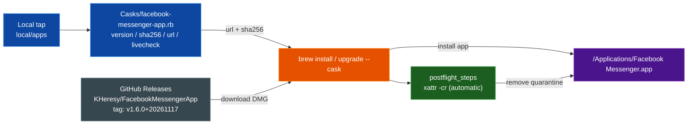
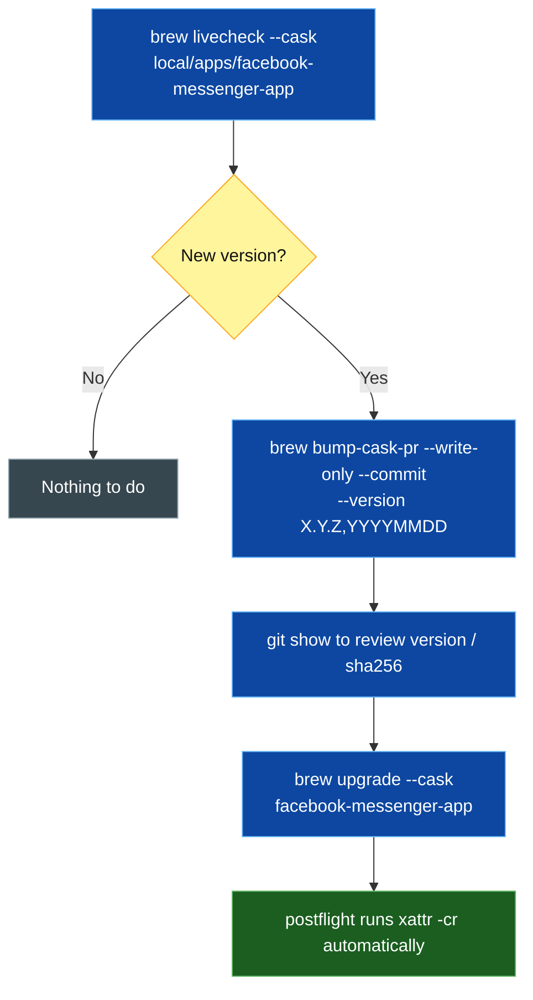

# Install Facebook Messenger App via a Homebrew Custom Tap (macOS)

[Back to README](README.md) | [繁體中文](README-macos-brew-tw.md)

This app is not signed with an Apple Developer certificate. After you install the DMG directly, macOS Gatekeeper often reports that the app "is damaged and can't be opened", and you have to run `sudo xattr -cr ...` yourself.

If you install it from a **Homebrew custom tap** instead, the cask's `postflight_steps` **automatically runs** `/usr/bin/xattr -cr` after every install or upgrade, so you don't have to type it by hand.

> **Analogy**: A tap is your own small shop. A cask is a "product card" on the shelf. The card says where to get the goods (`url`), how to check them (`sha256`), how to put them on the shelf (`app`), and what to do afterwards (`postflight_steps`). Homebrew is the clerk who follows the card. When a new version comes out, you only update the card.

## Architecture Overview



## 1. Create the Custom Tap (one-time setup)

### 1.1 Create the tap

```bash
brew tap-new local/apps
```

- The tap is created at `$(brew --repository)/Library/Taps/local/homebrew-apps`. On Apple Silicon, the default path is `/opt/homebrew/Library/Taps/local/homebrew-apps`.
- The directory is a git repository and includes `.github/workflows` templates. You only need those if you push the tap to GitHub.
- You can find it at any time with:

```bash
TAP_DIR="$(brew --repository local/apps)"
echo "$TAP_DIR"
```

> You can choose any name instead of `local/apps`. The format is `<user>/<repo>`, which maps to the directory `<user>/homebrew-<repo>`. To share the tap with others later, use your GitHub username, for example `yourname/apps`, and push it to `github.com/yourname/homebrew-apps`.

### 1.2 Get the DMG's SHA256

Find the latest tag on the [Releases](https://github.com/KHeresy/FacebookMessengerApp/releases) page (for example `v1.6.0+20261117`), then compute the DMG's hash:

```bash
VER=1.6.0
BUILD=20261117
curl -L -o /tmp/fbm.dmg \
  "https://github.com/KHeresy/FacebookMessengerApp/releases/download/v${VER}%2B${BUILD}/Facebook.Messenger-${VER}-arm64.dmg"
shasum -a 256 /tmp/fbm.dmg
```

> The `+` in the tag must be written as `%2B` in the URL.

### 1.3 Create the cask file

Create `"$(brew --repository local/apps)/Casks/facebook-messenger-app.rb"`:

```ruby
cask "facebook-messenger-app" do
  version "1.6.0,20261117"
  sha256 "b4d443531e230b947d13c33f783745d28311181af48641144cab22cd98aefec1"

  url "https://github.com/KHeresy/FacebookMessengerApp/releases/download/v#{version.csv.first}%2B#{version.csv.second}/Facebook.Messenger-#{version.csv.first}-arm64.dmg"
  name "Facebook Messenger App"
  desc "Unofficial Facebook Messenger desktop application"
  homepage "https://github.com/KHeresy/FacebookMessengerApp"

  livecheck do
    url :url
    regex(/^v?(\d+(?:\.\d+)+)\+(\d{8})$/i)
    strategy :github_latest do |json, regex|
      json["tag_name"]&.match(regex) do |match|
        "#{match[1]},#{match[2]}"
      end
    end
  end

  depends_on arch: :arm64
  depends_on macos: :tahoe

  app "Facebook Messenger.app"

  postflight_steps do
    run "/usr/bin/xattr",
        args: ["-cr", "{{appdir}}/Facebook Messenger.app"],
        sudo: true
  end
end
```

What each stanza does:

| Stanza | Purpose |
| --- | --- |
| `version "1.6.0,20261117"` | The upstream tag is `v1.6.0+20261117`. The two parts are separated by a comma here, and the URL rebuilds the tag from `version.csv.first` and `version.csv.second` |
| `sha256` | Hash of the DMG. brew refuses to install if the download doesn't match |
| `livecheck` | Reads `tag_name` from the latest GitHub release and converts it to the `1.6.0,20261117` format, so `brew livecheck` can detect new versions |
| `depends_on arch: :arm64` | Only the arm64 DMG is used, so the cask is limited to Apple Silicon |
| `depends_on macos: :tahoe` | Requires macOS 26 Tahoe **or later**. A bare symbol means `>=`, and `brew info` shows `macOS >= 26`. Without this line, `brew style` reports `Homebrew/OSDependsOn` |
| `app` | Copies the `.app` from the DMG to `/Applications` |
| `postflight_steps` → `run` | After installation, runs `xattr -cr` with `sudo` to remove the quarantine attribute. `{{appdir}}` expands to the app directory (`/Applications` by default) |

### 1.4 Check the cask and commit

```bash
cd "$(brew --repository local/apps)"

brew style --fix --cask local/apps/facebook-messenger-app  # lint, auto-fix where possible
brew livecheck --cask local/apps/facebook-messenger-app    # make sure livecheck finds a version

git add Casks/facebook-messenger-app.rb
git commit -m "Add Facebook Messenger App cask"
```

> The cask above already includes `depends_on macos: :tahoe`, so `brew style` should report `no offenses detected`.

### 1.5 Install

```bash
brew install --cask local/apps/facebook-messenger-app
```

At the end of the installation, brew asks for your password once because `xattr` runs with `sudo`. After that, you can open the app directly.

> If you previously installed the app manually from the DMG, delete `/Applications/Facebook Messenger.app` first, or run `brew install --cask --force ...` so brew takes over managing it.

## 2. Maintenance: Checking and Updating

### Workflow overview



### 2.1 Check for a new upstream version

```bash
brew livecheck --cask local/apps/facebook-messenger-app
```

Example output:

```text
facebook-messenger-app: 1.6.0,20261117 ==> 1.6.0,20261201
```

The left side of the arrow is the version in your tap, and the right side is the latest version on GitHub. If they match, you are up to date.

You can also see the installed version and the casks brew considers outdated:

```bash
brew info --cask local/apps/facebook-messenger-app
brew outdated --cask
```

> Note: `brew outdated` only compares the version in your tap with the installed version. If upstream has released a new version but your tap hasn't been updated yet, it shows nothing. Run `livecheck` first.

### 2.2 Update the cask in the tap (version + SHA256)

Use Homebrew's built-in `bump-cask-pr` with `--write-only`. It only modifies local files and does not open a remote PR. It downloads the new DMG and computes the SHA256 for you:

```bash
brew bump-cask-pr \
  --write-only \
  --commit \
  --version 1.6.0,20261201 \
  local/apps/facebook-messenger-app
```

- `--version` uses the same format as the cask, `<version>,<date>`. This is the string on the right side of the `livecheck` output.
- `--commit` creates a commit in the tap repository. Leave it out if you want to review the change and commit it yourself.

Review the change:

```bash
git -C "$(brew --repository local/apps)" show --stat HEAD
git -C "$(brew --repository local/apps)" show HEAD
```

#### Manual update (if bump-cask-pr fails)

1. Follow step 1.2 to download the new DMG and run `shasum -a 256`.
2. Edit `"$(brew --repository local/apps)/Casks/facebook-messenger-app.rb"` and change `version` and `sha256`.
3. Run `brew style --cask local/apps/facebook-messenger-app` to check the formatting.
4. Run `git commit -am "facebook-messenger-app <new version>"`.

### 2.3 Upgrade the app

```bash
brew upgrade --cask facebook-messenger-app
```

After the upgrade, `postflight_steps` runs `xattr -cr` again, so the upgraded app opens directly.

> The app's built-in update notification still tells you about new versions. **Upgrade through brew instead** of downloading the DMG and overwriting the app. A manual overwrite leaves brew with the wrong installed version, and you would have to run `xattr` yourself again.

### 2.4 One-liner

```bash
NEW=$(brew livecheck --cask --json local/apps/facebook-messenger-app | jq -r '.[0].version.latest') && \
brew bump-cask-pr --write-only --commit --version "$NEW" local/apps/facebook-messenger-app && \
brew upgrade --cask facebook-messenger-app
```

If you are already on the latest version, `bump-cask-pr` reports that the version is unchanged and stops without modifying any files. This requires `jq` (`brew install jq`).

### 2.5 Update the tap itself

- **Local-only tap (no remote, like `local/apps`)**: The tap contains only the files you commit, so there is nothing else to update. `brew update` only updates Homebrew itself and taps that have a remote.
- **Tap pushed to GitHub**:
    - Maintainer: run `git push` in the tap directory.
    - Users: run `brew update` to pull the latest cask, then run `brew upgrade --cask facebook-messenger-app`.

List your taps and view the tap's commit history:

```bash
brew tap
git -C "$(brew --repository local/apps)" log --oneline
```

## 3. Uninstall

```bash
brew uninstall --cask facebook-messenger-app   # remove the app
brew untap local/apps                          # remove the whole tap (deletes the tap directory; back it up or push first)
```

## Command Cheat Sheet

| Task | Command |
| --- | --- |
| Check for a new upstream version | `brew livecheck --cask local/apps/facebook-messenger-app` |
| Show install info | `brew info --cask local/apps/facebook-messenger-app` |
| Update cask version and SHA256 | `brew bump-cask-pr --write-only --commit --version <ver,date> local/apps/facebook-messenger-app` |
| Lint | `brew style --fix --cask local/apps/facebook-messenger-app` |
| Upgrade the app | `brew upgrade --cask facebook-messenger-app` |
| Reinstall | `brew reinstall --cask facebook-messenger-app` |
| Go to the tap directory | `cd "$(brew --repository local/apps)"` |
